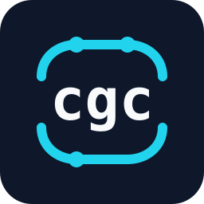

# cgc — `git clone` from scratch, in C

<p align="center">
  
</p>

[](https://github.com/campbell-nick/cgc/actions/workflows/ci.yml)

Version: 0.2.0

`cgc` is a self-contained implementation of `git clone` over the Git smart
HTTP protocol (version 2, with a protocol v0 fallback for older servers). It
does **not** shell out to `git`; it speaks the
protocol itself, validates and unpacks the packfile, resolves deltas, stores
packs and loose objects, writes refs, checks out the working tree, and writes a
Git index. It can also `fetch`, `pull`, and `update` an existing clone,
negotiating with `have` lines and fast-forwarding the current branch.

Clones can be bare (`--bare`), mirror every ref (`--mirror`), skip the
working-tree checkout (`--no-checkout`), use a custom remote name (`--origin
<name>`), or skip tags (`--no-tags`). Fetch and pull honor each remote's
configured fetch refspecs (including force, wildcard, and negative refspecs),
select a remote with `--remote <name>`, and fall back to `branch.<name>.remote`,
`origin`, or the first configured remote. Non-`origin` remotes update
`refs/remotes/<name>/*`, and a mirror fetch copies `refs/*` verbatim and prunes
deleted refs.

Besides smart HTTP, `cgc` clones and fetches from local repositories by reading
their refs and objects directly, including bare repositories, `file://` URLs,
and linked worktrees. It never invokes `git`.

Network requests have configurable timeouts (`CGC_HTTP_TIMEOUT`) and retry
transient `GET`/`HEAD` failures (`CGC_HTTP_RETRIES`). HTTP and HTTPS proxies are
honored through `http_proxy`, `https_proxy`, `all_proxy`, and `NO_PROXY`,
including proxy credentials and `CONNECT` tunnelling. Self-contained packs
received over HTTP are kept as `objects/pack/pack-<sha>.pack` with a v2 `.idx`;
thin packs fall back to loose objects.

Fetch and pull update remote-tracking refs and tags safely: a local tag that
differs from the remote is refused unless `--force` is given, `--no-tags` skips
tags, and `--prune` removes stale refs under the fetch refspec namespaces
(including packed refs). Pulls preserve unrelated staged changes and index flags
such as `skip-worktree` and `assume-unchanged`. `FETCH_HEAD` and `ORIG_HEAD` are
maintained, and ref, index, and metadata writes use atomic renames.

```sh
make
./cgc gh:octocat/Hello-World
cd Hello-World
../cgc fetch      # update remote-tracking refs
../cgc pull       # fetch and fast-forward
```

Install with `make install` (supports `PREFIX` and `DESTDIR`), which also
installs bash, zsh, and fish completions. Build a release tarball with
`make dist`. The version is tracked in `VERSION`.

Verified against GitHub and against `git http-backend` with repositories that
contain branches, annotated tags, nested trees, symlinks, executables and
deltas (both `ofs-delta` and `ref-delta`). Clones pass `git fsck --full` and
`git status` is clean; pulls are verified the same way. `make check` runs
offline unit and pack tests; `make network` covers timeouts, retries, and
proxies; `make test` adds the end-to-end smoke test and the comprehensive
feature matrix (`make features` runs the matrix on its own).

## Documentation

| Guide | Contents |
| --- | --- |
| [Build and test](docs/build.md) | Dependencies, building, installing, tests, releases, CI |
| [Usage](docs/usage.md) | Repository forms, URL shorthands, options, fetch/pull, output, safety, verifying a clone |
| [Architecture](docs/architecture.md) | How cloning, fetch, and pull work, and the source layout |
| [Supported and limitations](docs/limitations.md) | What works today, v1 limitations, roadmap |

## License

MIT. See [LICENSE](LICENSE).
